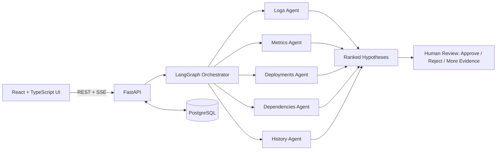
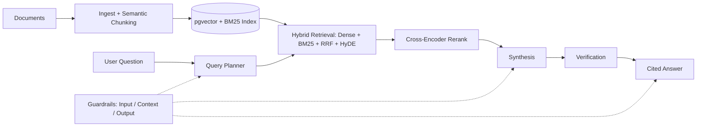

<!-- ======================= HEADER ======================= -->

 

---

## 👨‍💻 About

I am a **Computer Science undergraduate** who builds **full-stack and AI-powered products**. I like taking an unclear problem and owning it from the first line of code to final validation.

My work focuses on **backend APIs, real-time systems, LLM agents and retrieval pipelines**, with a strong habit of testing, tracing and measuring what I build.

| | |
|:--|:--|
| 🎓 **Education** | B.Tech in Computer Science & Engineering, **RGUKT Ongole** (2023 – 2027) · **CGPA 9.1 / 10** |
| 📍 **Location** | Ongole, Andhra Pradesh, India 🇮🇳 |
| 🔭 **Focus** | Agentic AI · RAG · LLM reliability · Production backends |
| 🎯 **Looking for** | ML / AI / Full-Stack internships and entry-level roles |
| 📫 **Reach me** | [srivardhansamgoju@gmail.com](mailto:srivardhansamgoju@gmail.com) |

---

## 🚀 Featured Projects

### 🔎 [IncidentLens](https://github.com/JayaSriVardhanSamgoju/IncidentLens) — Evidence-Driven Incident Investigation Platform

> An AI platform that helps operators find the root cause of an incident, using evidence from logs, metrics, deployments and past incidents. Every finding keeps its source, so nothing is a black box.

**What it does**
- Full-stack app: **React + TypeScript** frontend, **FastAPI** REST APIs, and **Server-Sent Events (SSE)** for live updates.
- A stateful **LangGraph** workflow that mixes rule-based root-cause analysis with **5 specialist agents**: logs, metrics, deployments, service dependencies and historical incidents.
- Keeps **evidence provenance** and shows **conflicting findings** instead of hiding them.
- **Human-in-the-loop** review: `APPROVE`, `REJECT` or `REQUEST MORE EVIDENCE`.
- Live timeline with **SSE reconnect and event replay**, typed API clients and system health monitoring.

| Tests passed | End-to-end scenarios | Specialist agents |
|:--:|:--:|:--:|
| **312 / 312** | **15 / 15** | **5** |

---

### 📚 [SynoptiQ](https://github.com/JayaSriVardhanSamgoju/SynoptiQ) — Enterprise Agentic RAG & Document Intelligence Platform

> Ask questions about your documents and get answers backed by evidence, with **page-level citations** so you can check every claim.

**What it does**
- Multi-format document ingestion, hybrid retrieval, grounded answers and **page-level citation tracing**.
- **LangGraph multi-agent pipeline:** query planning → hybrid retrieval → synthesis → verification.
- **High-precision retrieval:** dense vector search + **BM25** + **Reciprocal Rank Fusion** + **HyDE** + **cross-encoder reranking**.
- **Defense-in-depth security:** input, context and output guardrails for prompt injection, jailbreaks, PII, API-key leaks, indirect context poisoning and system-prompt leakage, with security evaluation and regression tests.
- **Production-ready upgrades:** PostgreSQL + **pgvector**, Redis-backed ephemeral BYOK sessions, async document workers, semantic chunking, **OpenTelemetry** tracing, automated RAG evaluation and CI/CD checks.

---

## 🛠️ Tech Stack

<table>
<tr>
<td width="190"><b>💻 Languages</b></td>
<td>

</td>
</tr>
<tr>
<td><b>⚙️ Backend & Data</b></td>
<td>

 REST APIs · SQLAlchemy · SSE · pgvector
</td>
</tr>
<tr>
<td><b>🎨 Frontend</b></td>
<td>

</td>
</tr>
<tr>
<td><b>☁️ Cloud & DevOps</b></td>
<td>

 CI/CD · OpenTelemetry · Monitoring
</td>
</tr>
<tr>
<td><b>🧠 AI / ML</b></td>
<td>

 LLMs · RAG · Agentic AI · LangChain · LangGraph · XGBoost
</td>
</tr>
<tr>
<td><b>🔍 Retrieval & NLP</b></td>
<td>

</td>
</tr>
</table>

---

## 📊 GitHub Activity

---

## 🏆 Achievements & Certifications

- 🥇 **Top 4 team**, KL University Hyderabad Hackathon, for a **GST Reconciliation** solution that improves financial data validation pipelines.
- 🎓 **NPTEL Elite**: Foundations of Deep Learning (**81%**), an IIT-backed MOOC.
- 🚀 **Ignite India Entrepreneurship Program**, Wadhwani Foundation.

---

## 🧭 How I Work

| Principle | What it means |
|:--|:--|
| **Evidence first** | Every answer or finding should point back to its source. |
| **Test everything** | Automated tests, end-to-end checks and evaluation before I call something done. |
| **Safe by design** | Guardrails, human review and observability are part of the build, not an afterthought. |
| **Own the whole thing** | Design, backend, frontend, deployment and validation. |

---

## 🎯 Currently

- 🔨 Improving **SynoptiQ** toward production-scale (reliability, tracing, evaluation)
- 📖 Studying **LLM reliability** and ways to reduce hallucinations
- 🧪 Practising **DSA** and strengthening core fundamentals
- 🎓 Final year B.Tech · Expected graduation **May 2027**

---

## 🤝 Let's Connect

  

If you like my work, a ⭐ on my repositories is always appreciated.

