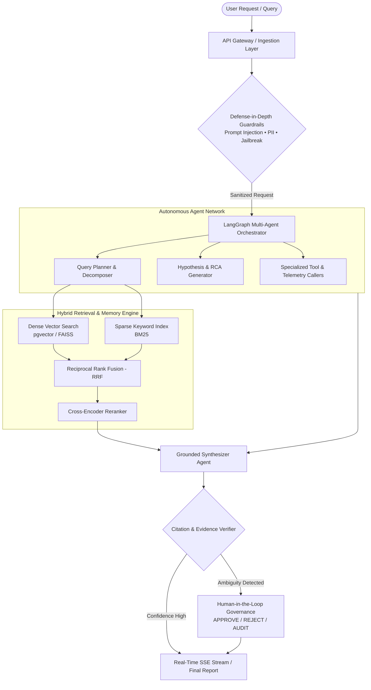

<!-- ======================= HEADER BANNER ======================= -->

  

<!-- ======================= QUICK BADGES ======================= -->

  
  &nbsp;
  
  &nbsp;
  
  &nbsp;
  
  &nbsp;
  

<!-- ======================= TYPING ANIMATION ======================= -->

  

---

<!-- ======================= ABOUT ME ======================= -->
## 🧑‍💻 Executive Summary

**Computer Science Undergraduate & AI Systems Engineer** specializing in architecting production-grade, full-stack, and agentic AI platforms. Experienced in engineering stateful multi-agent workflows, enterprise hybrid RAG pipelines, and high-concurrency real-time backend systems.

- 🎓 **Education:** B.Tech in Computer Science & Engineering — **RGUKT, Ongole** (CGPA: **9.1 / 10.0** | 2023 – 2027)
- 🏛️ **Pre-University:** RGUKT, RK Valley (CGPA: **9.2 / 10.0**) & JNV (Class X: **83%**)
- 📍 **Location:** Ongole, Andhra Pradesh, India 🇮🇳
- 🧠 **Core Competencies:** Stateful LangGraph Orchestration, Hybrid Retrieval (Dense Vector + BM25 + Cross-Encoder), Human-in-the-Loop Governance, Real-Time SSE Streams, and Defense-in-Depth AI Guardrails.
- ⚙️ **Engineering Philosophy:** Fundamentals-first architecture, deterministic root-cause analysis (RCA), and production reliability (**312/312 tests & 15/15 E2E scenarios passing**).
- 🏆 **Hackathons & Certifications:** Top 4 Finalist @ KL University Hackathon (GST Reconciliation) | NPTEL Elite — Foundations of Deep Learning (81%) | Wadhwani Foundation Ignite India.

 

---

<!-- ======================= TECH STACK ======================= -->
## 🛠️ Technical Arsenal

<b>🧠 Agentic AI, LLMs & Retrieval</b>

 

  
  
  
  
  
  
  
  
  
  

<b>⚡ Backend, Real-Time Systems & Databases</b>

 

  
  
  
  
  
  
  
  

<b>🎨 Frontend & Application Interface</b>

 

  
  
  
  
  

<b>☁️ DevOps, Cloud & Observability</b>

 

  
  
  
  
  
  
  
  

<b>💻 Programming Languages</b>

 

  
  
  
  
  
  

---

<!-- ======================= FEATURED PROJECTS ======================= -->
## 🚀 Production & Flagship Projects

<table>
  <tr>
    <td width="50%" valign="top">
      <h3 align="center">🔍 IncidentLens</h3>
      
<b>Evidence-Driven Autonomous Incident Investigation Platform</b>

      

        
        
        
        
        
      

      <ul>
        <li><b>Autonomous Multi-Agent RCA:</b> Built a stateful LangGraph workflow combining deterministic RCA with 5 specialized agents for logs, metrics, deployments, service dependencies, and historical incidents.</li>
        <li><b>Human-in-the-Loop Governance:</b> Engineered review workflows supporting <code>APPROVE</code>, <code>REJECT</code>, and <code>REQUEST_MORE_EVIDENCE</code> to eliminate automated hallucination risks.</li>
        <li><b>Real-Time Event Stream:</b> Integrated live incident timelines via Server-Sent Events (SSE) with reconnect resilience and event replay.</li>
        <li><b>Battle-Tested:</b> <b>312/312 tests passed</b> with <b>15/15 E2E scenarios validated</b>.</li>
      </ul>
      

        <a href="https://github.com/JayaSriVardhanSamgoju"><b>View Repository ➜</b></a>
      

    </td>
    <td width="50%" valign="top">
      <h3 align="center">⚡ SynoptiQ</h3>
      
<b>Enterprise Agentic RAG & Document Intelligence Platform</b>

      

        
        
        
        
        
      

      <ul>
        <li><b>Hybrid Retrieval & Fusion:</b> Multi-agent pipeline combining dense vector search, BM25 keyword matching, Reciprocal Rank Fusion (RRF), HyDE, and Cross-Encoder reranking.</li>
        <li><b>Defense-in-Depth Guardrails:</b> Multi-tiered security covering prompt injections, jailbreaks, PII masking, API-key leaks, and indirect context poisoning.</li>
        <li><b>Citation Tracing:</b> Page-level grounded citation tracing ensuring zero hallucinated answers across multi-page PDF, DOCX, and TXT files.</li>
        <li><b>Scale Ready:</b> Redis ephemeral BYOK sessions, asynchronous workers, and OpenTelemetry distributed tracing.</li>
      </ul>
      

        <a href="https://github.com/JayaSriVardhanSamgoju/Agentic-Document-Intelligence-Engine"><b>View Repository ➜</b></a>
      

    </td>
  </tr>
  <tr>
    <td width="50%" valign="top">
      <h3 align="center">📈 CloudPulse AI</h3>
      
<b>Predictive Cloud Capacity & FinOps Auto-Scaler</b>

      

        
        
        
        
      

      <ul>
        <li><b>Proactive Predictive Scaling:</b> Uses machine learning to forecast CPU, request traffic, and latency surges up to 60 minutes in advance.</li>
        <li><b>Eliminates Cold Boots:</b> Circumvents the 2–7 minute VM/container spin-up lag of reactive thresholds.</li>
        <li><b>Cost Reduction:</b> Cuts idle cloud infrastructure costs by <b>20% to 45%</b> while maintaining strictly flat p95/p99 SLA response times.</li>
      </ul>
      

        <a href="https://github.com/JayaSriVardhanSamgoju/Cloud_FinOPs_Engine"><b>View Repository ➜</b></a>
      

    </td>
    <td width="50%" valign="top">
      <h3 align="center">🏭 Industrial Failure Detection</h3>
      
<b>Real-Time Streaming Sensor ML Anomaly Pipeline</b>

      

        
        
        
        
      

      <ul>
        <li><b>Real-Time Event Stream:</b> Continuously ingests multi-sensor industrial telemetry over Apache Kafka topics with sub-second latency.</li>
        <li><b>Adaptive Anomaly Detection:</b> Unsupervised Isolation Forest model with adaptive thresholding for dynamic failure severity classification.</li>
        <li><b>MLOps & Drift Monitoring:</b> Tracks experiment lifecycles with MLflow and continuously audits statistical data drift with EvidentlyAI.</li>
      </ul>
      

        <a href="https://github.com/JayaSriVardhanSamgoju/Real-Time-Industry-Equipment-Failure-Detection-System"><b>View Repository ➜</b></a>
      

    </td>
  </tr>
</table>

---

<!-- ======================= SYSTEM ARCHITECTURE ======================= -->
## 🏛️ System Architecture Blueprint

---

<!-- ======================= GITHUB ANALYTICS ======================= -->
## 📊 GitHub Analytics & Observability

  
  &nbsp;
  

  

  

  

---

<!-- ======================= SNAKE ANIMATION ======================= -->
## 🐍 Contribution Stream

  

---

<!-- ======================= HONORS & CERTIFICATIONS ======================= -->
## 🏆 Honors & Certifications

| Honor / Certification | Issuer / Organization | Details |
| :--- | :--- | :--- |
| 🥇 **Top 4 Finalist — National Hackathon** | KL University, Hyderabad | Built an automated GST Reconciliation engine optimizing corporate financial data validation pipelines |
| 📜 **NPTEL Elite — Foundations of Deep Learning** | IIT-backed MOOC (Score: **81%**) | Rigorous mathematical and architectural grounding in neural networks, backpropagation & CNN/RNN design |
| 🚀 **Ignite India Entrepreneurship Program** | Wadhwani Foundation | Certified in technology innovation, scalable system design, and venture ideation |
| 🧠 **Generative AI & LLMs Certification** | GeeksforGeeks | Multi-stage prompt engineering, transformer attention mechanisms, and LLM fine-tuning |

---

<!-- ======================= CONNECT ======================= -->
## 🤝 Let's Connect & Collaborate

  
  &nbsp;&nbsp;
  
  &nbsp;&nbsp;
  
  &nbsp;&nbsp;
  

  

<!-- ======================= FOOTER ======================= -->

  

